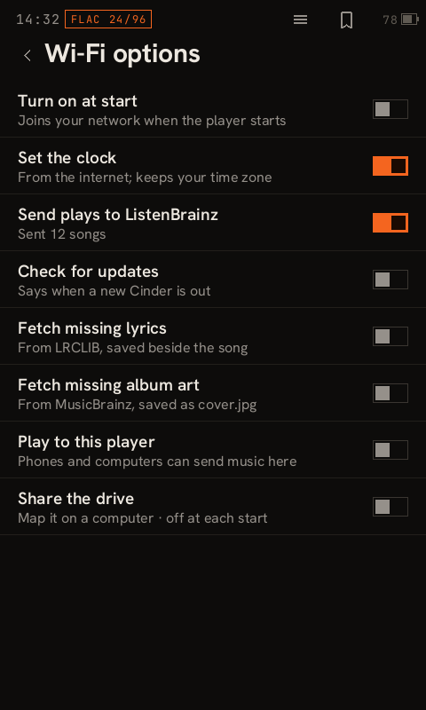
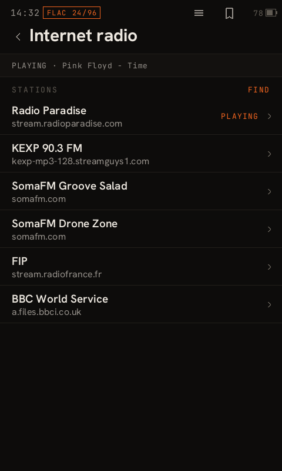
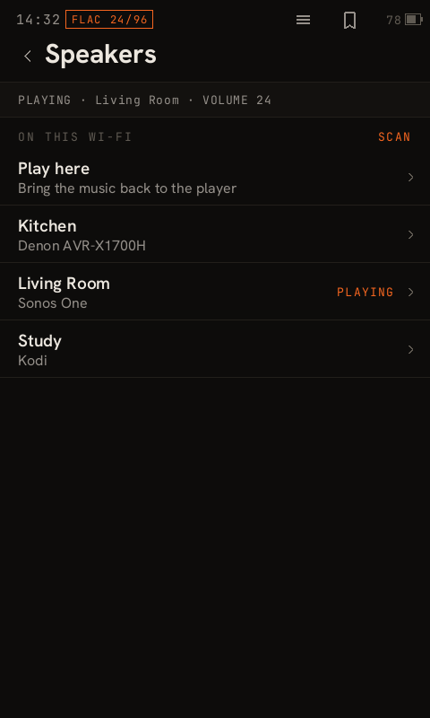
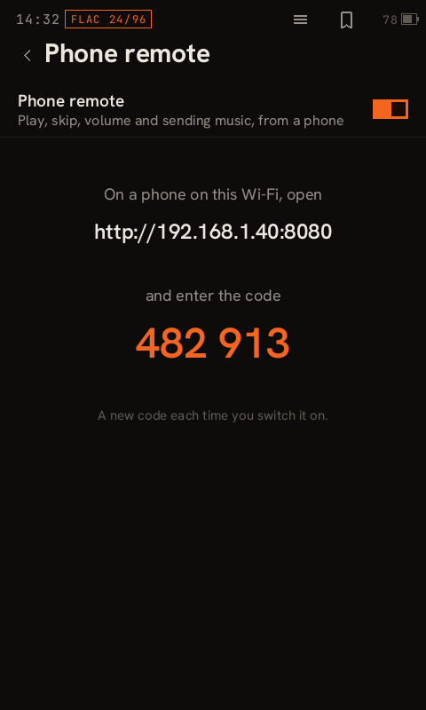
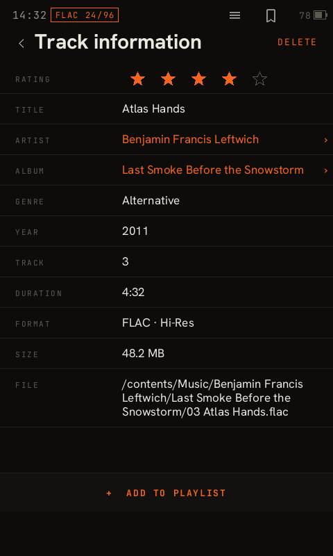

<!--
  The top of the v0.4.0 release page (and of its -rcN pre-releases). release.yml swaps {{TAG}} for
  the tag being released, so the images come from that tag's tree, and puts the shared install
  and verify text (.github/release-notes.md) below this. Write the lines marked OWNER yourself.
-->

  
  
  
  
  

<h1 align="center">Cinder 0.4: the Walkman gets Wi-Fi</h1>

<b>Internet radio · AirPlay · network speakers · sync without the cable</b>

The NW-A50 series has a Wi-Fi chip that Sony never switched on. In 0.4 Cinder switches it on,
and the player can now talk to everything else in your home: it plays internet radio, sends your
music to a speaker in another room, takes a song from your phone, and syncs with Flint without a
cable.

<!-- OWNER: a few lines in your own words — why you built this, what you use it for, what you'd
     like people to try first. -->

> [!IMPORTANT]
> **Wi-Fi is an install option, and off until you want it.** Tick **Device ▸ Wi-Fi** in the
> installer, then switch it on in **Settings ▸ Wi-Fi**. Every network feature below has its own
> switch, and each is off until you turn it on. Skip the option and the player works as it did in
> 0.3.

## What Wi-Fi brings

| | |
|---|---|
| **📻 Internet radio** | MP3 and AAC stations, HLS streams (BBC, Radio France), and now FLAC and WAV, through the headphone jack or Bluetooth, with the song title the station sends. **FIND** searches radio-browser.info by name or genre and lists only stations the player can play. |
| **🔊 Speakers** | Send Up Next to a speaker on your network: Sonos and other UPnP/DLNA speakers, AV receivers, smart TVs, Kodi, or anything with Google Cast. It picks up at the same song and second, and the player's buttons and volume keys control the speaker. **Play here** brings it back. |
| **📱 AirPlay and Play to this player** | The player shows up as **Walkman (Cinder)** on iPhones and Macs (AirPlay), and in phone apps like BubbleUPnP and Windows' *Cast to device* (UPnP/DLNA). |
| **🗂 Share the drive** | The player's storage as a network drive. Map it on Windows or macOS and copy music to it, or sync with Flint over Wi-Fi exactly as over the cable. |
| **🎛 Phone remote** | A page on your network, locked by a 6-digit code the player shows. Play, skip, volume, and sending music to the player from a phone. |
| **✨ Small things that help** | Set the clock from the internet. Fetch missing lyrics (LRCLIB) and album art (MusicBrainz). Send your plays to ListenBrainz. A daily check for a new Cinder. |

## Also new since 0.3.21

- **Delete music** (off by default, Settings ▸ Library). A **DELETE** on Track information and on
  each album page, always with a confirmation. Handy now that music can arrive over Wi-Fi.
- **Settings has pages.** One row per topic instead of one long scroll, and Back returns you to
  the topic you came from.
- **Make it your own.** Night on a schedule. Swipe up or down on Now Playing to open the screen you
  choose. A back arrow and track number on Now Playing. Hold can lock the buttons. A Folders tab
  in the Library. A bigger top bar and icons in Big view. Each one is a setting you switch on.
- **Bluetooth sounds better on more headphones.** SBC XQ now adapts to the signal the way LDAC's
  Best effort does. **Best** lets the link take the best codec your headphones share, and plain
  SBC sits beside SBC XQ for headphones whose radio can't carry XQ.
- **Smoother scrolling.** The stall at the start of every drag is gone. Frames went from 21-31 ms
  spikes to 12 ms at worst.
- **One installer, both builds.** Every installer carries Stable and the Developer build, and
  **Save a report** collects what's needed for a bug report in one click.

<b>Fixed since 0.3.21</b> (the ones you're most likely to have hit)

- A player left on a wall charger no longer drops out of Cinder for good (#52).
- A big library no longer locks Cinder out of starting, and every row gets its cover (#46).
- The headphone jack plays again next to Wampy (#43).
- Installing on a player running Walkman One works again (#41).
- ◁ on a paused song goes back to 0:00 and stays paused (#50).
- Folders list their songs by file name (#45).
- An album whose first song's cover won't load takes the cover from its other songs (#53).
- A playlist's Shuffle follows Settings ▸ Shuffle (#53).
- The Bluetooth screen names an SBC link instead of `CODEC 0x01` (#44).
- No more cut-off sentences at large text sizes.

Everything else, with how each change was tested, is in
[CHANGELOG.md](https://github.com/superwilso/Cinder/blob/{{TAG}}/CHANGELOG.md).

## Tested, and not yet

Cinder's changelog says what has run on a real player and what hasn't, and so does this page.

| Ran on a player | Built and tested, not yet on a player |
|---|---|
| Joining Wi-Fi, the clock, the update check, HTTPS with certificate checks | AirPlay from an iPhone |
| Internet radio from three stations through the jack | Radio and AirPlay over Bluetooth |
| The phone remote, including an upload landing in the library | Speakers against a real Sonos or Chromecast (tested against simulated ones) |
| Smoother scrolling, Settings pages | Share the drive (tested from Windows 11 and with Flint) |
| | Play to this player (tested with a UPnP client), FLAC and WAV, Delete music |
| | WPA3, ListenBrainz with a real account, the battery cost of Wi-Fi |

> [!TIP]
> If something on the right doesn't work for you, an issue with the installer's **Save a report**
> attached is the most useful thing you can send.

## Thank you

To everyone who reported, tested and suggested. Many of the fixes and settings above started in
your issues: **IvanMaestroGTR** (#41, #43, #44, #45, #50, #51), **plaquette** (#52, #53) and
**yuuji-kun** (#46).

<!-- OWNER: anyone else you want to thank. -->

